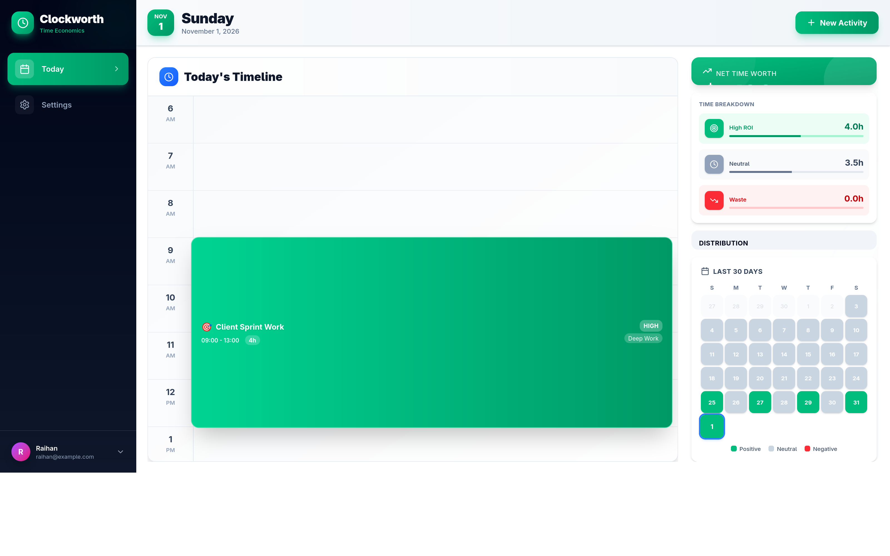
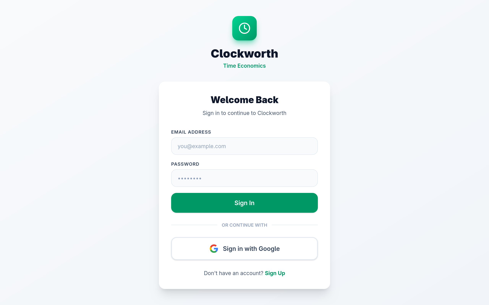

# Clockworth ⏳

> Personal time economics and activity ROI tracking application.

Clockworth treats your time like financial capital. Beyond just counting hours, it calculates the monetary value and leverage of your day by pairing your target hourly rate with ROI classifications.

---



---

## What It Does

- **Visual 24-Hour Timeline**: Interactive daily time-blocking grid to schedule, view, edit, and adjust activities throughout your day.
- **Time Economics & Net Value**: Set your custom hourly worth rate (`hourly_worth`) to calculate the true value of your logged time.
- **ROI Categorization**:
  - 🟢 **High**: Strategic, high-leverage deep work (2.0x value multiplier).
  - ⚪ **Neutral**: Essential routine, operations, and maintenance (1.0x multiplier).
  - 🔴 **Waste**: Low-leverage distractions and time sinks (0.0x multiplier).
- **30-Day Activity Heatmap**: Visualize daily consistency and productivity patterns over the past month.
- **Dual Authentication**:
  - Fast, standalone **Email & Password** signup and login with bcrypt hashing.
  - Optional **Google OAuth2** single sign-on with secure HTTP-only cookies.

---

## Preview

| Landing Page | Authentication |
|:---:|:---:|
|  |  |

---

## Tech Stack

- **Backend**: Go 1.24, Echo v4
- **Database**: PostgreSQL with [sqlc](https://sqlc.dev/) (type-safe SQL) and [dbmate](https://github.com/amacneil/dbmate) (migrations)
- **Frontend**: SvelteKit, TypeScript, TailwindCSS, Lucide Icons

---

## Quick Start

### 1. Configure Environment

```bash
git clone https://github.com/RaihanStark/clockworth.git
cd clockworth

cp .env.example .env
```

### 2. Start Database & Run Migrations

```bash
# Start PostgreSQL container
make dev-up

# Apply schema migrations
make migrate-up
```

### 3. Run Backend API

```bash
make run
```
*API runs on `http://localhost:8080`.*

### 4. Run Frontend

In a separate terminal:

```bash
cd web
npm install
npm run dev
```
*Web app runs on `http://localhost:5173`.*

---

## License

MIT
